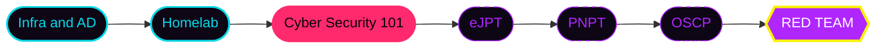
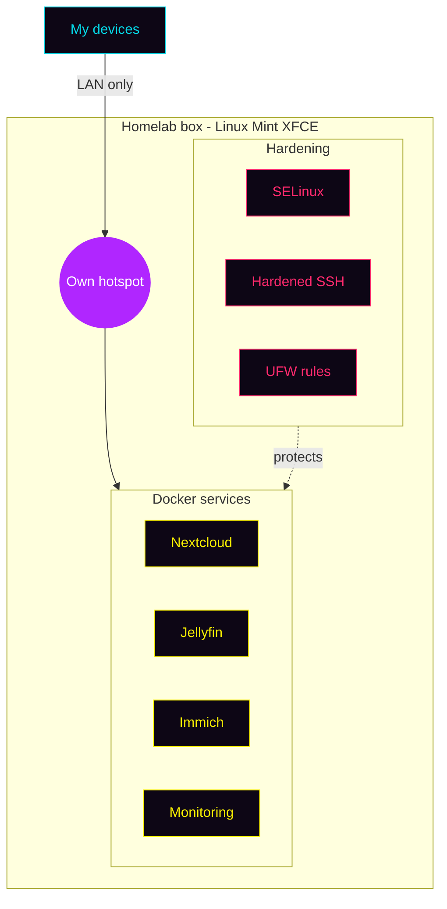

<div align="center">

```text
██████╗  █████╗ ██████╗ ███████╗███████╗
██╔══██╗██╔══██╗██╔══██╗██╔════╝██╔════╝
██████╔╝███████║██████╔╝███████╗█████╗  
██╔═══╝ ██╔══██║██╔══██╗╚════██║██╔══╝  
██║     ██║  ██║██║  ██║███████║███████╗
╚═╝     ╚═╝  ╚═╝╚═╝  ╚═╝╚══════╝╚══════╝
```

[](https://github.com/YOUR_USERNAME)


[](https://tryhackme.com/p/YOUR_USERNAME)
[](https://linkedin.com/in/YOUR_HANDLE)
[](mailto:YOUR_EMAIL)

</div>

<br/>

## $\color{cyan}\textbf{//\ WHOAMI}$

```python
class Parse:
    handle       = "YOUR_HANDLE"
    base         = "Bengaluru, IN"
    role         = "Pentester in progress"
    long_game    = "Red Team Operator"
    day_job      = "keeping ~400 systems alive and on the domain"
    nights       = ["TryHackMe", "homelab", "CTFs", "breaking my own builds"]
    fuel         = {"chaos": True, "curiosity": True, "phonk": "always on"}
    current_boss = "Cyber Security 101"

    def next_move(self):
        return "own the next box"
```

> [!IMPORTANT]
> **Current mission:** finish TryHackMe Cyber Security 101, then go for **eJPT**. Every lab gets written up in public.

<br/>

## $\color{magenta}\textbf{//\ ARSENAL}$

| | |
|:--|:--|
| **$\color{magenta}\textsf{OFFENSIVE}$** |       |
| **$\color{cyan}\textsf{DEFENSE}$** |     |
| **$\color{violet}\textsf{INFRA}$** |      |
| **$\color{yellow}\textsf{BUILD}$** |      |

<br/>

## $\color{yellow}\textbf{//\ SKILL\ TREE}$



<br/>

## $\color{violet}\textbf{//\ LAB\ NETWORK}$



<br/>

## $\color{cyan}\textbf{//\ BUILDS}$

<table>
<tr>
<td width="50%" valign="top">

**$\color{cyan}\textsf{SENTINEL}$** `proposal done, build next`

Internal network vulnerability and asset management platform, built with a team. **Discover, Prioritize, Validate, Mobilize.** Stealthy discovery, safe validation, usable by non-experts, and it speeds up a human pentester instead of replacing one.

</td>
<td width="50%" valign="top">

**$\color{magenta}\textsf{BEAT\ THE\ AI}$** `open day centerpiece`

Real-time emotion detection and music recommender. Pi Zero W streams video to an OpenCV DNN pipeline running a FERPlus ONNX model, with a custom emotion mapper and a scoreboard so visitors can try to fool the AI.

</td>
</tr>
<tr>
<td width="50%" valign="top">

**$\color{yellow}\textsf{HOMELAB}$** `98% uptime over 4 weeks`

Dockerized Nextcloud, Jellyfin, Immich and monitoring behind SELinux, hardened SSH and UFW. Runs its own hotspot, so everything is LAN only. Becomes a cyber range after eJPT.

</td>
<td width="50%" valign="top">

**$\color{violet}\textsf{HARDWARE\ LAB}$** `pi zero w`

Pwnagotchi, Bjorn, P4wnP1 ALOA and ESP32 Marauder, all folded into the red team track. Also fixes hardware for fun, like tracing an Intel ME POST error to a BIOS fix.

</td>
</tr>
</table>

<br/>

## $\color{cyan}\textbf{//\ LIVE\ TELEMETRY}$

<div align="center">

<a href="https://github.com/YOUR_USERNAME"></a>
<a href="https://github.com/YOUR_USERNAME"></a>

<a href="https://github.com/YOUR_USERNAME"></a>

</div>

<br/>

## $\color{magenta}\textbf{//\ PLAYER\ STATS}$

```ini
[progress]
bandit_levels_cleared = 10        ; OverTheWire, keep going
thm_path              = Cyber Security 101
thm_streak            = YOUR_STREAK_DAYS
boxes_owned           = YOUR_BOX_COUNT
certs                 = 0         ; eJPT is the first one
meetups_attended      = 0         ; null / OWASP Bangalore, soon

[loadout]
shell   = bash
distro  = Linux Mint XFCE
mood    = "chaos, but organized"
```

<br/>

## $\color{yellow}\textbf{//\ QUEST\ BOARD}$

> [!NOTE]
> **Active:** TryHackMe Cyber Security 101

> [!TIP]
> **Next:** eJPT, then PNPT, then OSCP

> [!WARNING]
> **Side quest:** ship Sentinel, and attend a null or OWASP Bangalore meetup

<br/>

## $\color{cyan}\textbf{//\ REPOS}$

| Repo | What it is |
|:--|:--|
| [`red-team-journey`](https://github.com/YOUR_USERNAME/red-team-journey) | Public log of the grind, wins and faceplants included |
| [`pentest-portfolio`](https://github.com/YOUR_USERNAME/pentest-portfolio) | Write-up templates, cheatsheets and reports |

<br/>

## $\color{magenta}\textbf{//\ SNAKE.EXE}$

<div align="center">
<picture>
  <source media="(prefers-color-scheme: dark)" srcset="https://raw.githubusercontent.com/YOUR_USERNAME/YOUR_USERNAME/output/snake-dark.svg" />
  <source media="(prefers-color-scheme: light)" srcset="https://raw.githubusercontent.com/YOUR_USERNAME/YOUR_USERNAME/output/snake.svg" />
  
</picture>
</div>

<br/>

<div align="center">

$\color{magenta}\textsf{learn\ it\ by\ building\ it}$ &nbsp; $\color{cyan}\textsf{understand\ it\ by\ breaking\ it}$ &nbsp; $\color{yellow}\textsf{legally}$

<sub>now playing: phonk // drift mode: ON</sub>

</div>
