<div align="center">
  
</div>

<div align="center">


[](https://tryhackme.com/p/parodyparse)
[](https://www.linkedin.com/in/YOUR_LINKEDIN_HANDLE)

</div>

<br>

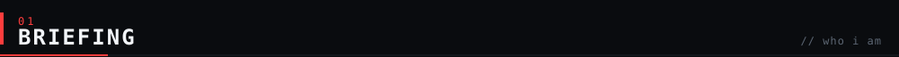

I run Windows and Active Directory infrastructure for a living and spend my nights learning how to break it. The plan is simple: land a junior pentest role by graduation in April 2027, then grow into red team work. Everything I learn gets written up in public, minus flags and answer keys.

```text
name      : Parse
base      : Bengaluru, India
day job   : Residential Engineer, on-site at a large organization (since April 2024)
studying  : BCA, evening classes
mission   : junior pentester by graduation, red teamer after
method    : labs, CTFs, breaking things on purpose, then writing it down
```

<div align="center">
  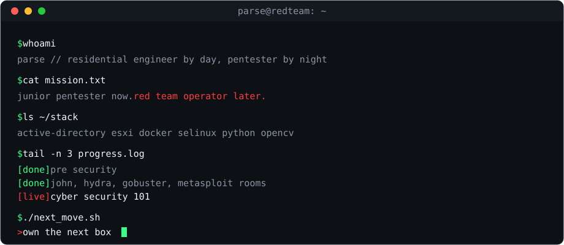
</div>

<br>

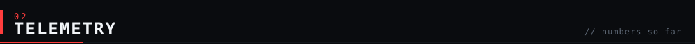

<div align="center">
  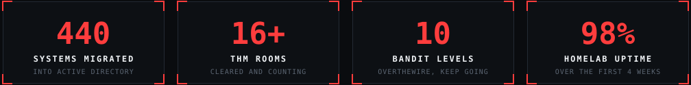
</div>

<br>

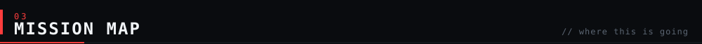

<div align="center">
  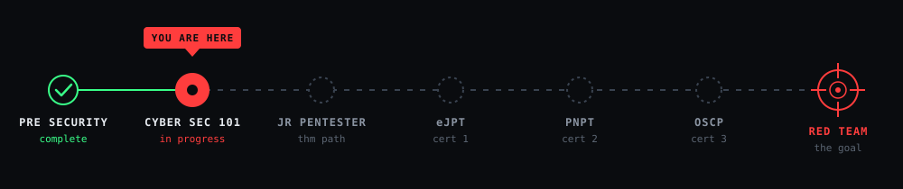
</div>

| Phase | What is on the board |
|:--|:--|
| **Now** | TryHackMe Cyber Security 101 (Exploitation Basics), rolling out Wazuh at work, a write-up for every room |
| **Next** | First solo CTF run, finish Cyber Security 101, Junior Penetration Tester path, wire Wazuh into my IT assistant, turn the homelab into a cyber range, attend a null / OWASP Bangalore meetup |
| **Later** | eJPT, then PNPT, then OSCP, then red team roles |

<br>

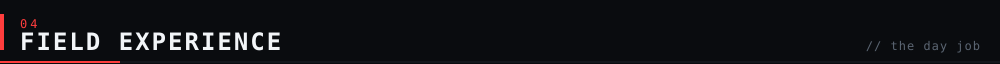

**Residential Engineer** | on-site at a large organization | April 2024 to now

- Migrated 440 local-account Windows systems into Active Directory with USMT, keeping each user's local profile alongside the new domain profile.
- Built the supporting stack on ESXi: Active Directory, print management, GLPI issue tracking, phpIPAM, MECM, remote desktop services and Zabbix monitoring, all LAN only.
- Started rolling out Wazuh for endpoint security monitoring.
- Built and run a local AI assistant (Qwen 3.5 35B with RAG and LibreChat) wired into GLPI, AD and MECM to flag issues and help fix them.
- Wrote a serial-to-database bridge for a lab analyzer, moving its COM port output into a LAN database over ODBC.

Why this matters for red teaming: knowing how AD, profiles, monitoring and ticketing work from the admin side shows me what defenders see and what attackers abuse.

<br>

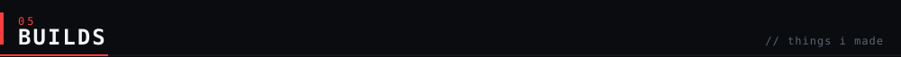

<table>
<tr>
<td width="50%" valign="top">

**Sentinel** `proposal done, build next`

Internal network vulnerability and asset management platform, built with a team. Finds what is on the network, ranks what matters, validates it safely, and hands the result to a human instead of replacing one.

</td>
<td width="50%" valign="top">

**Beat the AI** `college open day`

Real-time emotion detection and music recommender. A Pi Zero W streams video to an OpenCV DNN pipeline running a FERPlus ONNX model, and visitors compete on a scoreboard to fool it.

</td>
</tr>
<tr>
<td width="50%" valign="top">

**Homelab** `98% uptime over the first 4 weeks`

Nextcloud, Jellyfin, Immich and monitoring in Docker, behind SELinux, hardened SSH and UFW. Runs on its own hotspot, LAN only. Becomes a cyber range once the basics are solid.

</td>
<td width="50%" valign="top">

**Hardware lab** `pi zero w and friends`

Pwnagotchi, Bjorn, P4wnP1 ALOA and ESP32 Marauder, to be folded into the red team track later. Also fixes dead hardware for fun, like tracing a POST error to a BIOS fix.

</td>
</tr>
<tr>
<td width="50%" valign="top">

**Analyzer bridge** `python, serial, odbc`

Takes the serial output of a lab analyzer and pushes it into a LAN database, so results land where the lab staff can use them without manual entry.

</td>
<td width="50%" valign="top">

**IT copilot** `qwen 3.5 35b, rag, librechat`

A locally hosted LLM trained on our own applications through RAG. It helps staff resolve IT issues and write code, and it is connected to GLPI, AD and MECM so it can raise alerts and suggest fixes. Wazuh integration is next.

</td>
</tr>
</table>

<br>

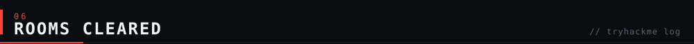

<details open>
<summary><b>Cyber Security 101</b> (in progress)</summary>
<br>

| Room | Topic | Status |
|:--|:--|:--|
| John the Ripper | Hash cracking, wordlists, rules | done |
| MonikerLink (CVE-2024-21413) | Outlook moniker bug, NTLM leak | done |
| Metasploit: Introduction | msfconsole, modules, sessions | done |
| Metasploit: Exploitation | Exploit modules, payloads, shells | done |
| Hydra | Online password attacks | done |
| Gobuster | Directory and file enumeration | done |

**Lesson from Gobuster:** I lost time to a "can't connect" error because I forgot to restart dnsmasq after editing its config. Check that the name resolves before blaming the tool.

</details>

<details>
<summary><b>Pre Security</b> (complete)</summary>
<br>

Offensive Security Intro, Defensive Security Intro, Careers in Cyber, Inside a Computer System, Computer Types, Client-Server Basics, Virtualisation Basics, Cloud Computing Fundamentals, Operating Systems: Introduction, Windows Basics, plus the rest of the path.

</details>

Also done: **OverTheWire Bandit**, levels 0 to 10 so far.

Full notes live in [`pentest-portfolio`](https://github.com/sparse-pirate/pentest-portfolio) and the day-by-day record in [`red-team-journey`](https://github.com/sparse-pirate/red-team-journey).

<br>

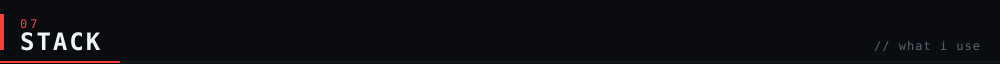

| | |
|:--|:--|
| **lab-tested offense** |      |
| **defense** |      |
| **infra** |       |
| **build** |        |

<br>

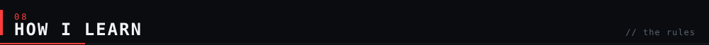

1. **Hands-on first.** Labs and CTFs beat reading. Theory gets pulled in when a task needs it.
2. **Every room gets written up.** In my own words, with the commands, the mistakes and why it matters for red teaming. No flags, no answer keys.
3. **Small daily sessions.** Showing up for 15 minutes beats a marathon I never start.
4. **Break it on purpose.** My own homelab is the first target I harden and the first one I try to break.
5. **Authorized targets only.** TryHackMe, CTF platforms, intentionally vulnerable labs and my own gear.

<br>

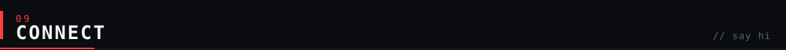

[](https://tryhackme.com/p/parodyparse)
[](https://www.linkedin.com/in/YOUR_LINKEDIN_HANDLE)
[](https://github.com/sparse-pirate/red-team-journey)


<div align="center">
  <sub>learn it. break it. write it up.</sub>
</div>
